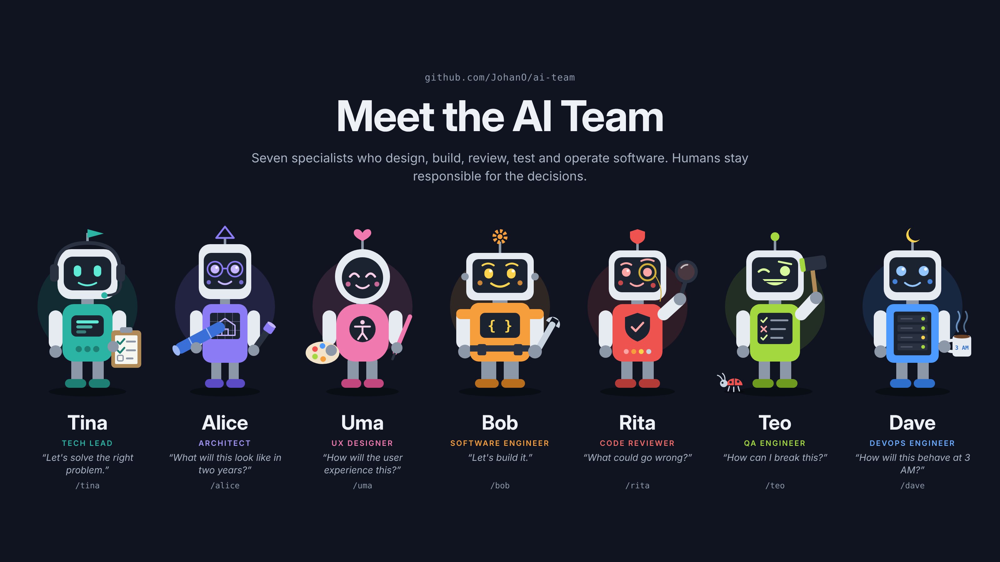

# AI Team

A team of AI software professionals who collaborate to design, build, review, test, and operate software through reusable personas, standards, and playbooks. It runs on [Claude Code](https://claude.com/claude-code) as a set of slash commands.

## Team

| Command | Name | Role | Ask them to... |
| --- | --- | --- | --- |
| `/tina` | Tina | Tech Lead | break down a task, decide who should be involved, define success criteria |
| `/alice` | Alice | Architect | evaluate architecture, dependencies, scalability, design options |
| `/uma` | Uma | UX Designer | define user flows, interaction design, accessibility |
| `/bob` | Bob | Software Engineer | plan and implement code changes |
| `/rita` | Rita | Code Reviewer | review code for quality, security, maintainability |
| `/teo` | Teo | QA Engineer | define test strategy, edge cases, regression risks |
| `/dave` | Dave | DevOps Engineer | assess deployment, infrastructure, monitoring, reliability |



Each team member has a defined role, responsibilities, priorities, and output format. See [team.md](team.md) for the roster and [working-agreement.md](working-agreement.md) for how they collaborate and resolve disagreements.

## Guiding Principles

- Humans remain responsible for decisions.
- Favor clarity over cleverness.
- Prefer simple solutions. Apply [SWAN](standards/swan.md): the Simplest Working Approach Now.
- Consider maintainability first.
- Always evaluate accessibility and usability.
- Document decisions and tradeoffs.

## Getting started

### Prerequisites

- [Claude Code](https://claude.com/claude-code) (CLI, desktop app, or IDE extension)
- Git
- On Windows: PowerShell. On macOS/Linux: bash.

### Install

The personas are Claude Code [custom slash commands](https://docs.claude.com/en/docs/claude-code/slash-commands). Installing copies them to `~/.claude/commands` so they are available in **every** project you open with Claude Code.

1. Clone the repository somewhere permanent. The installed commands point back to this folder, so don't move or delete it afterwards.

   ```bash
   git clone https://github.com/JohanO/ai-team.git
   cd ai-team
   ```

2. Run the installer for your OS.

   Windows (PowerShell):

   ```powershell
   .\install-commands.ps1
   ```

   macOS / Linux:

   ```bash
   ./install-commands.sh
   ```

   You should see one `Installed /<name>` line per command (12 in total).

3. Restart Claude Code (or start a new session) so it picks up the new commands. Type `/` and you should see `/tina`, `/alice`, `/feature` and the rest in the list.

To install somewhere other than `~/.claude/commands`, pass a destination: `.\install-commands.ps1 -Destination <path>` or `./install-commands.sh <path>`.

### Update

```bash
git pull
```

Then re-run the installer. Re-run it as well if you edit a command in `.claude/commands/`, or if you moved the repository.

### Uninstall

Delete the installed files from `~/.claude/commands`: `alice.md`, `bob.md`, `dave.md`, `rita.md`, `teo.md`, `tina.md`, `uma.md`, `team.md`, `bug.md`, `feature.md`, `refactor.md`, `release.md`.

### Try it without installing

Open Claude Code **inside this repository**. The same commands are available there directly, namespaced as `/people:alice`, `/workflows:feature`, and so on, with no installation needed.

## Using the team

Work in your own project as usual and call on team members when you need them. Describe the task after the command.

### Consult one person

```
/alice Should we put the notification service behind a queue or call it synchronously?
/rita Review the changes on this branch
/teo What edge cases are we missing in the checkout form?
```

Each persona answers from their own perspective, in their own output format, and stays in character. Rita, for example, classifies findings as Critical, Major, Minor, or Nitpick.

### Not sure who to ask? Ask Tina

```
/team We need to add CSV export to the reports page
```

Tina does not do the work. She tells you who is required, who is optional, the order to engage them, the risks, and the success criteria. Then you call those people yourself. `/tina` does the same but stays in character in a longer conversation.

### Run a whole workflow

Workflows walk several team members through a playbook, with each one building on the previous person's findings, and present the result under each person's name.

| Command | Use it for | Sequence |
| --- | --- | --- |
| `/feature` | A new feature | Tina, Alice, Uma, Bob, Rita, Teo, Dave |
| `/bug` | Investigating and fixing a bug | Teo, Alice, Bob, Rita, Teo, Dave |
| `/refactor` | Improving maintainability without changing behavior | Alice, Bob, Rita, Teo |
| `/release` | Safely deploying to production | Dave, Teo, Tina |

```
/feature Users should be able to export any report as CSV
/bug Login fails with a blank page after the session times out
```

Only the participants relevant to the task are included.

### Tips

- Be specific. Include the goal, constraints, and anything already decided.
- The team makes recommendations, not decisions. You stay responsible for the outcome.
- When specialists disagree, the [working agreement](working-agreement.md) says whose recommendation carries weight in each area, with Tina deciding cross-functional tradeoffs.
- Personas read the standards in `standards/` (coding, architecture, UX, accessibility, testing, SWAN). Edit those to match your team's conventions.

## Repository structure

- `personas/` Individual team members
- `standards/` Shared engineering standards
- `playbooks/` Repeatable workflows
- `.claude/commands/` Command templates (`people/`, `workflows/`, `team.md`)
- `install-commands.ps1`, `install-commands.sh` Install the commands globally
- `team.md`, `working-agreement.md`, `team-charter.md` Roster, collaboration rules, and charter

## How it works

Each command is a short markdown prompt that tells Claude which files to load (persona, standards, working agreement) and to act as that persona. The files in `.claude/commands/` reference them by relative path, which only resolves inside this repository. The installer flattens the commands into `~/.claude/commands` and rewrites those references to absolute paths into your clone, so they work from any project.

## Feedback

This project is in early testing and feedback is very welcome. Please [open an issue](https://github.com/JohanO/ai-team/issues) or contact the maintainer. Useful things to tell us:

- Which command you used and the prompt you gave it
- Whether the answer was helpful, too long, off-role, or out of character
- Anything that was unclear in these instructions or failed during installation
- Which persona, standard, or workflow is missing
